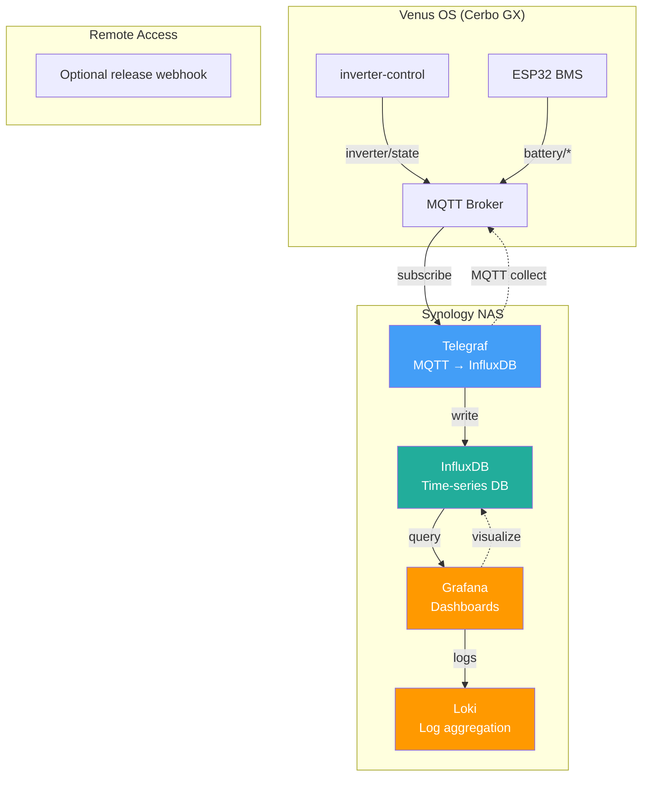
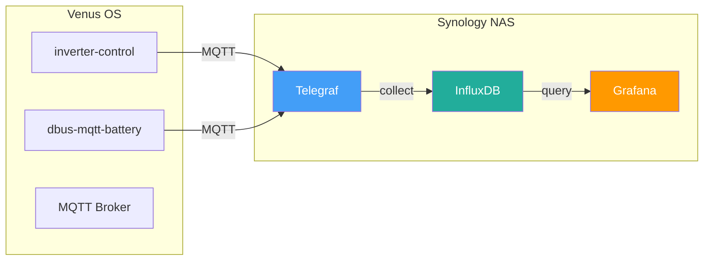
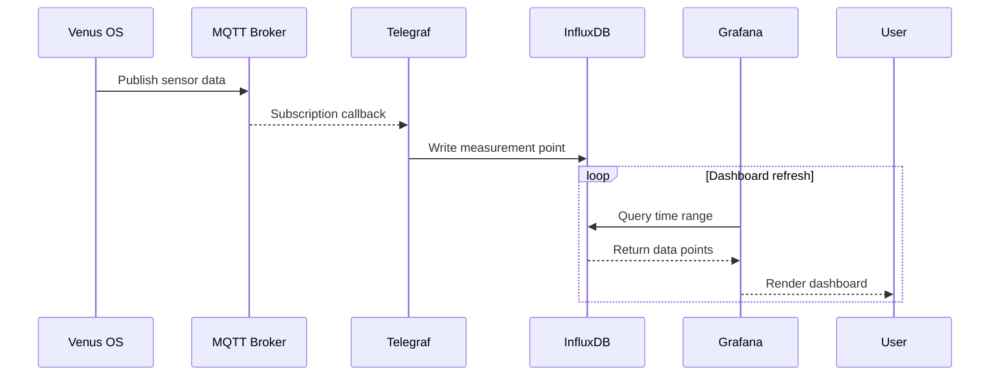
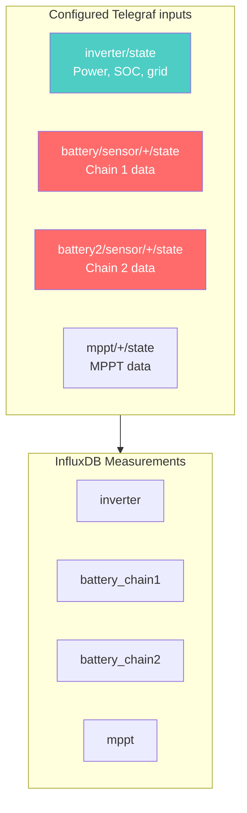

# System Architecture

See [the deployment guide](../../README.md#release-webhook-and-manual-deployment)
and [access configuration](../../docs/secure-deployment.md) for current operating
requirements. The optional authenticated webhook has automatic deployment
disabled by default; push events do not deploy this stack.

## Data Flow Diagram



## Service Dependencies



## Data Collection Flow



## MQTT Topics Mapping

These are the inputs configured in [telegraf.conf](../../telegraf.conf). The
optional MPPT input expects normalized JSON on `mppt/+/state` with `power`,
`voltage` and `current` fields. It needs a publisher that supplies that format;
native Venus topics alone do not populate this input.



## Runbook: Troubleshooting

### No Data Appearing in Grafana

**Symptoms:**
- Dashboard shows "No data"
- InfluxDB queries return empty

**Actions:**
```bash
# Verify Telegraf is running
docker ps | grep telegraf

# Check Telegraf logs
docker logs telegraf -f

# Test MQTT subscription
docker exec telegraf mosquitto_sub -v -t "#"

# Verify InfluxDB connectivity
docker exec telegraf nc -zv influxdb 8086
```

### High Memory Usage from Telegraf

**Symptoms:**
- NAS memory nearly full
- Telegraf container using excessive RAM

**Actions:**
```toml
# Reduce Telegraf buffer size in telegraf.conf
[agent]
  metric_buffer_limit = 1000

# Or restrict collected topics
[[inputs.mqtt_consumer]]
  topics = ["inverter/state", "battery/sensor/+/state"]
```

### Grafana Dashboard Not Loading

**Symptoms:**
- Blank panels
- Timeout errors

**Actions:**
```bash
# Check Grafana container
docker ps | grep grafana
docker logs grafana --tail 50

# Verify data source
curl -s http://localhost:3000/api/datasources

# Restart container
docker restart grafana
```

---

## Related Documentation

- [inverter-control System Architecture](https://github.com/victron-venus/inverter-control/blob/main/.github/docs/system-architecture.md)
- [ADR-001: Grid-Zero Architecture](https://github.com/victron-venus/inverter-control/blob/main/.github/docs/adr-001-grid-zero-architecture.md#adr-001-grid-zero-control-architecture)
